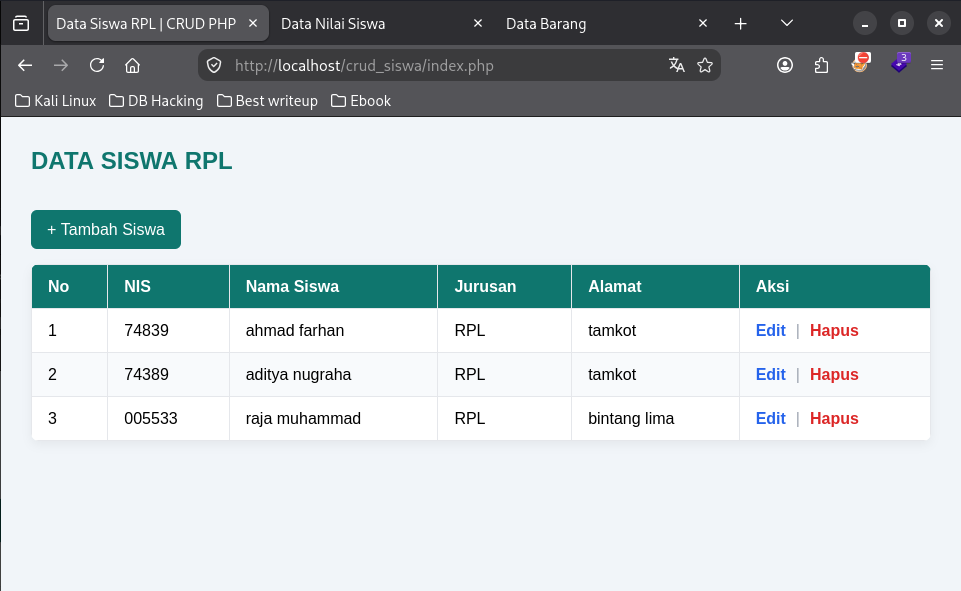
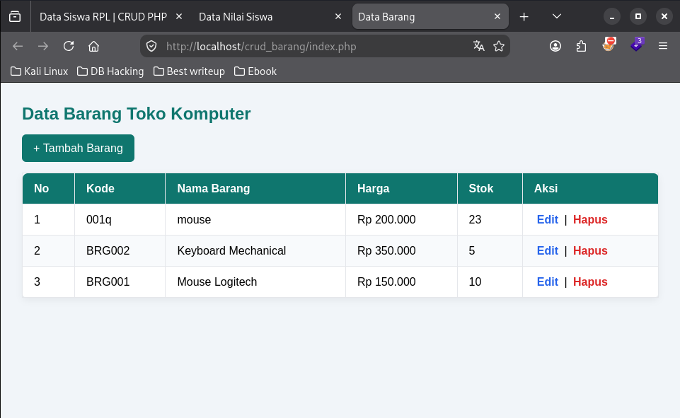
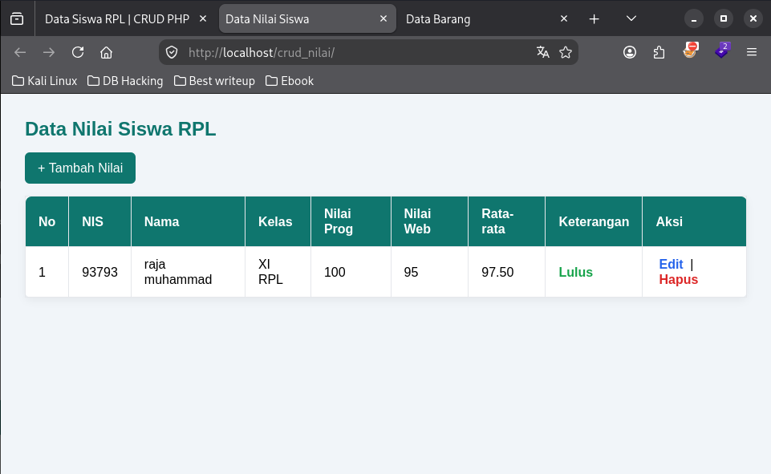

# Crud Praktek

Praktik CRUD PHP (LAMP) yang dibuat:

## 1. crud_siswa — Data Siswa RPL
- Database: `db_sekolah`, tabel `siswa` (id, nis, nama, jurusan, alamat)
- File: koneksi.php, index.php, tambah.php, edit.php, hapus.php, db_sekolah.sql

## 2. crud_barang — Data Barang Toko Komputer
- Database: `db_toko`, tabel `barang` (id, kode_barang, nama_barang, harga, stok)
- File: koneksi.php, index.php, tambah.php, edit.php, hapus.php, db_toko.sql

## 3. crud_nilai — Data Nilai Siswa
- Database: `db_nilai`, tabel `nilai_siswa` (id, nis, nama, kelas, nilai_pemrograman, nilai_web)
- Fitur tambahan: kolom Rata-rata = (Nilai Pemrograman + Nilai Web)/2, Keterangan (Lulus jika ≥75, Belum Lulus jika <75)
- File: koneksi.php, index.php, tambah.php, edit.php, hapus.php, db_nilai.sql

## Cara uji di LAMP
1. Import SQL: `mysql -uroot < db_*.sql`
2. Taruh folder di `/var/www/html/`
3. Akses `http://localhost/crud_siswa/`, `/crud_barang/`, `/crud_nilai/`
4. Uji tambah, edit, hapus, dan cek perhitungan rata-rata/keterangan (nilai).# crud-praktek
